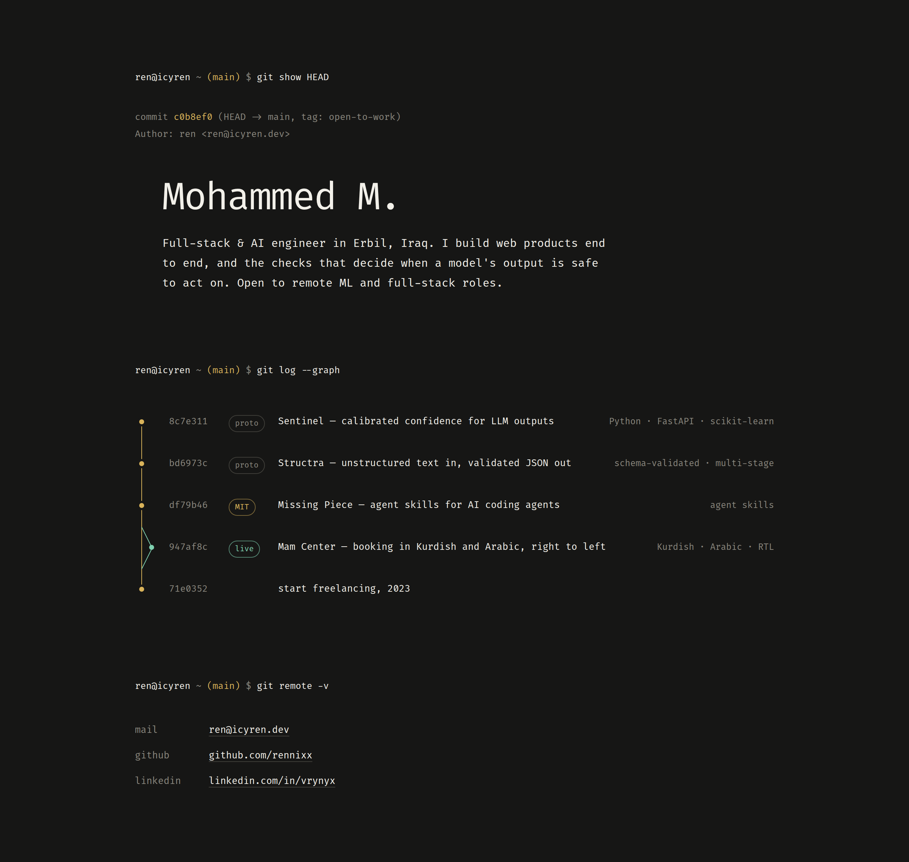
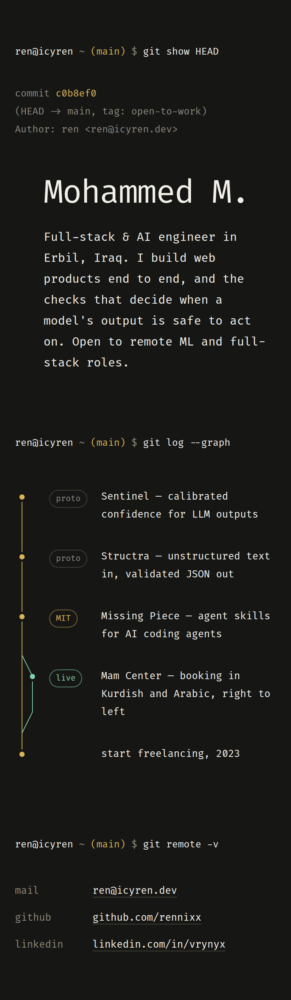

<div align="center">

# Mohammed M.

A portfolio written as a git log.

[](https://icyren.dev)

<br/>



<br/>



</div>

## About

Full-stack and AI engineer in Erbil, Iraq. The page is one screen: the latest commit is the introduction, the work is a commit graph, and the contact links are remotes.

## Features

- **Now playing.** A small strip at the top right shows the current or last played track from stats.fm.
- **Commit graph.** A gold line for main, and a mint branch for Mam Center that merges back.
- **Keyboard.** Enter or Space expands a commit. Escape closes it. Links inside an open row stay in the tab order.
- **Reduced motion.** The expand animation is skipped when it is requested, and the now-playing equaliser is still.
- **Mobile.** Hashes and the stack column hide, and the graph stays a narrow rail.

## Stack

[](https://nextjs.org)
[](https://react.dev)
[](https://tailwindcss.com)
[](https://www.framer.com/motion/)
[](https://fonts.google.com/specimen/Fira+Code)

Fira Code is loaded with `next/font`.

## Project structure

```
src/
├── app/
│   ├── layout.tsx          # Font, metadata, document shell
│   ├── page.tsx            # Assembles the log
│   └── globals.css         # Color tokens and focus styles
├── components/
│   ├── NowPlaying.tsx      # stats.fm strip at the top right
│   ├── HeadCommit.tsx      # git show HEAD
│   ├── CommitGraph.tsx     # Expandable project rows
│   ├── GraphRail.tsx       # Gold and mint graph lines
│   ├── Remotes.tsx         # git remote -v
│   ├── PageShell.tsx       # 980px column
│   └── Prompt.tsx          # ren@icyren ~ (main) $
├── lib/
│   ├── now-playing.ts      # stats.fm payload parser
│   └── get-now-playing.ts  # Server fetch
└── data/
    └── log.ts              # Intro and commit list
```

The intro and the commits live in `src/data/log.ts`. Contact links live in `src/components/Remotes.tsx`.

## Now playing

A compact strip at the top right of the page shows what is playing, or what was last played. It reads the public stats.fm API and needs no key. Set this on the [Vercel](https://vercel.com) project as a server env var (not `NEXT_PUBLIC_`):

- `STATSFM_USER` — your stats.fm username

If it is missing, the strip is not rendered.

## Local development

```bash
npm install
npm run dev
```

Open [localhost:3000](http://localhost:3000).

```bash
npm run build
npm run start
```

## Deployment

Push `master`. [Vercel](https://vercel.com) builds the site and serves it at [icyren.dev](https://icyren.dev).

## Contact

- [ren@icyren.dev](mailto:ren@icyren.dev)
- [github.com/rennixx](https://github.com/rennixx)
- [linkedin.com/in/vrynyx](https://linkedin.com/in/vrynyx)
